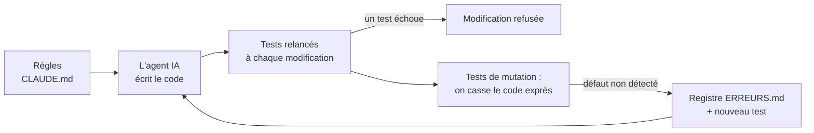

# Fiabiliser des données produites avec une IA

Une démonstration courte : comment empêcher un outil de données, écrit par un agent IA, d'afficher une information fausse comme « vérifiée ».

**Le cas** : un agent IA de prospection cherche des entreprises sur le web et produit des fiches (nom, SIRET, code postal) pour une équipe commerciale. Avant qu'un commercial s'en serve, `verifier.py` compare ce que l'IA affirme à la base officielle (API publique [Recherche d'entreprises](https://recherche-entreprises.api.gouv.fr), données SIRENE) et range chaque fiche en **vérifiée**, **à corriger** ou **bloquée**.

**Qui fait quoi** : le code et les tests sont écrits par un agent IA (Claude Code). Je cadre le travail, j'écris les règles, je vérifie les résultats et je décide de ce qui est accepté.

## L'IA est contrôlée à deux endroits

| Où | Ce que l'IA peut faire de travers | Ce qui le rattrape |
|---|---|---|
| **Dans les données qu'elle produit** | Inventer une entreprise ou un SIRET, donner une information périmée, confondre deux entreprises, se tromper d'adresse, mal recopier un numéro | Le vérificateur : chaque fiche est comparée à la base officielle, et bloquée en cas de doute |
| **Dans le code qu'elle écrit** | Des tests « au vert » qui ne protègent pas tout | Les tests de mutation : on casse le code exprès pour vérifier que les tests le remarquent |

| Erreur typique d'un agent IA | Fiche d'exemple ou test qui la reproduit | Résultat |
|---|---|---|
| Entreprise inventée (hallucination) | « Entreprise inventée par l'agent » | bloquée : SIRET introuvable |
| Information périmée | Camaïeu (cessée fin 2023) | bloquée : entreprise cessée |
| Adresse erronée | Fnac Darty, code postal 75001 | à corriger : 94200, avec la preuve |
| Numéro mal recopié | « Doctolib (dernier chiffre faux) » | bloquée avant même d'interroger la base |
| Zéro initial perdu à l'export | « Fnac Darty (SIRET tronqué à l'export) » | bloquée : 13 chiffres |
| Confusion avec une autre entreprise | état « autre_entreprise » de la matrice de tests | bloquée : SIRET différent |

Les fiches d'exemple n'ont pas été produites par un vrai agent : elles ont été construites à la main pour reproduire ces erreurs typiques, sur des entreprises dont les données sont publiques.

## Le circuit



## Les règles (extrait de [CLAUDE.md](CLAUDE.md))

- **Dans le doute, on bloque.** API en panne, réponse ambiguë, entreprise fermée : la fiche est bloquée, jamais « vérifiée ».
- **Le fichier saisi n'est jamais modifié.** Une correction est proposée dans `sortie/propositions.json`, avec l'ancienne valeur, la nouvelle et la preuve. Un humain la valide.
- **Minimisation (RGPD).** On ne recopie que les champs utiles, jamais les dirigeants. Une entreprise non diffusible est bloquée sans rien recopier.
- **Toute règle a un test qui échoue sans elle**, prouvé par un test de mutation.

## Ce qui a été vérifié (29/10/2026)

| Contrôle | Résultat |
|---|---|
| Tests automatiques (`pytest`) | 43 tests passent, sans aucun appel réseau |
| Matrice de pannes ([tests/test_matrice.py](tests/test_matrice.py)) | 3 états de fiche × 8 états de réponse de l'API, chaque combinaison avec son statut attendu |
| Tests de mutation ([outils/mutations.py](outils/mutations.py)) | **Premier passage : 10 sur 13 détectées.** Les trous ont été fermés et inscrits au [registre](ERREURS.md). Passage suivant : 14 sur 14 |
| Hook (`.claude/settings.json`) | Avec le défaut de démonstration ci-dessous, 2 tests échouent et la modification est refusée |
| Exécution réelle sur [data/prospects_exemple.csv](data/prospects_exemple.csv) | 2 vérifiées, 1 à corriger, 4 bloquées ; fichier d'entrée inchangé (empreinte identique) |

Le premier passage des mutations a montré que des tests « au vert » ne protégeaient pas tout : une API en panne pouvait se faire passer pour un SIRET inexistant, et un établissement au SIRET différent pouvait être accepté. Voir [ERREURS.md](ERREURS.md).

## Lancer

```bash
python -m venv .venv
.venv/Scripts/python -m pip install -r requirements.txt   # sous Linux/macOS : .venv/bin/python
.venv/Scripts/python -m pytest -q
.venv/Scripts/python verifier.py data/prospects_exemple.csv
.venv/Scripts/python outils/mutations.py
```

Le script se termine avec le code 1 s'il reste une fiche bloquée : elle doit être vue par un humain.

## Le défaut de démonstration

Dans `verifier.py`, remplacer `return _verdict("a_corriger"` par `return _verdict("verifiee"`. C'est le défaut le plus grave possible : une fiche à corriger présentée comme vérifiée. Les tests le détectent et le hook refuse la modification.

## Limites

- Les tests utilisent des réponses d'API fabriquées. Un changement de format de l'API réelle serait bloqué (réponse inexploitable), mais n'est pas testé contre l'API réelle elle-même.
- L'exécution réelle a porté sur 7 fiches d'exemple, une fois.
- Les mutations sont écrites à la main ; elles ne couvrent que les règles listées dans `outils/mutations.py`.
- Le vérificateur ne contrôle que ce qui existe dans la base officielle (identité, état, code postal). Une information que la base ne contient pas (un téléphone, un nom de contact) ne peut pas être vérifiée par cet outil.
